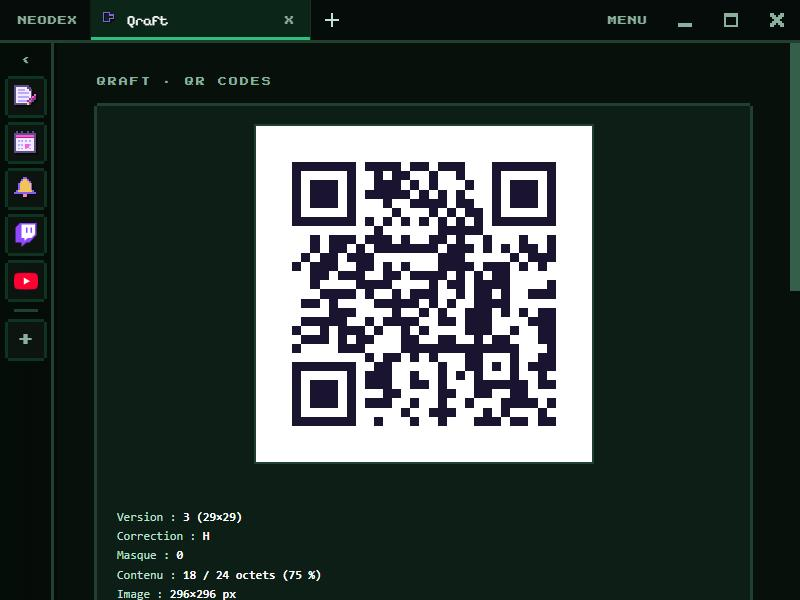

# Qraft

Make crisp pixel QR codes, ready to print or share.

*Version française : [README.md](README.md)*

## Read a QR code (new in 1.1.0)

Read a QR code on screen or in an image (even damaged or rotated), checked centre logo, round or rounded dots.

## Contents

- Free **Text** and **Link** (`https://` is added if missing).
- **Wi-Fi**: network name, password, security (WPA, WEP, none), hidden network. A phone that reads the code connects on its own. **The password is never saved**: not in the plugin folder, not in the recent list.
- **Contact** (vCard: name, phone, e-mail, company, website), **E-mail** (to, subject, message), **SMS**, **Location** (latitude, longitude).

## Settings

- **Correction** L, M, Q or H: the share of the code that can be damaged (or covered by a logo) without hurting reading, from 7 to 30 %. The stronger it is, the bigger the code.
- **Ink** and **background**: a pixel art palette or any colour. A warning shows if the ink is lighter than the background or the contrast is too low.
- **Margin** (4 modules recommended) and **module size** in pixels.
- The version (code size), the chosen mask and the space used are shown.

## Export

**PNG**, **SVG** (sharp at any size) or **Copy the image**. **★ Keep** puts the code in the **recent** list (10 at most) to find it again in one click.

## Reliability

The encoder follows the ISO 18004 standard (byte mode, versions 1 to 40, Reed-Solomon, 8 masks, the best one picked automatically). Each time it opens, test codes are made then read back by a small built-in decoder, which checks they give back the original text.

## Reading a QR code, logo, dots (1.1.0)

- **READ ON SCREEN**: NeoDex hides for a moment, takes a screenshot and looks for a QR code in it (« Your screen » permission, the screenshot never leaves your PC). **READ AN IMAGE…** does the same with an image, and you can also paste an image (Ctrl+V). The text read shows with **COPY**, **OPEN THE LINK** for a web address and **EDIT HERE** to load it in the form. The reader fixes damaged dots (logo, scratch) and reads straight or rotated codes, not ones photographed at an angle.
- **Logo in the centre**: an image in the middle of the code; correction then goes to level H, and Qraft reads the drawn code back to tell you whether it stays readable.
- **Dots**: squares, round or rounded; the three big corner squares stay square so readers can find them. PNG and SVG keep the dots and the logo.

## Data

The content (without Wi-Fi password), the settings and the recent list are kept in the plugin folder. Permission: `storage` only.
